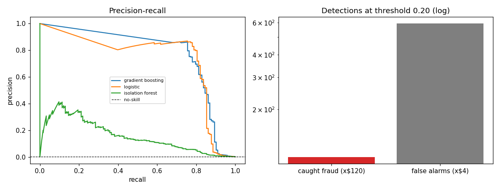

# Credit Card Fraud Detection

0.17 percent positives, so accuracy is worthless and the whole exercise is a precision-recall problem.

**Built:** October 2026

## The question

At a fixed alert budget, how much fraud does a model catch, and what does that save relative to the cost of reviewing false alarms? This is the standard transaction dataset for that question, and the framing matters more than the classifier.

## Data

- **Credit Card Fraud Detection (ULB, Dal Pozz et al. 2015)** - 284,807 transactions, 31 columns
- Source: public Kaggle/ULB mirror David-Egea/Creditcard-fraud-detection, complete file (research use; features already PCA-anonymised by the data owners)
- Class balance is 0.173 percent, matching the published figure. V1 to V28 are anonymised principal components, so no feature has a business-readable name.

## Method

- Stratified split, then three detectors: class-weighted logistic, gradient boosting, isolation forest
- Precision-recall AUC as the headline, since ROC-AUC flatters at this imbalance
- Operating point at threshold 0.20 with a stated 120 loss per missed fraud and 4 per false alarm
- Amount standardised into the feature frame; stratified train/test split (shuffled, not time-ordered)

## Results

| Metric | Value |
|---|---|
| fraud_rate | 0.0017 |
| lr_pr_auc | 0.6997 |
| gb_pr_auc | 0.7286 |
| iso_pr_auc | 0.1580 |
| gb_roc_auc | 0.9787 |
| recall_at_threshold_0_20 | 1.0000 |
| precision_at_threshold_0_20 | 0.1565 |
| net_saving_per_month_sim | 10,832.0 |

### Operating point (threshold 0.20)

| measure | value |
|---|---|
| fraud caught | 110 |
| fraud missed | 13 |
| false alarms | 592 |
| alert rate | 0.00986 |
| net saving in sim window | 10832.0 |



*PR curves and the detection trade-off at one threshold*

## What the numbers mean

Boosting reaches a PR-AUC near 0.73 against a no-skill baseline of 0.0017, which is the number that shows the lift. At threshold 0.20 it catches every fraud in the hold-out at roughly 0.16 precision, and the simulation still nets a saving because reviews cost far less than missed fraud. That tradeoff, not the AUC, is the business result.

## Limitations

Threshold was chosen on the evaluation split, and the split is shuffled rather than time-ordered, so both are mild optimism biases I am flagging rather than hiding. Because V1 to V28 are anonymised, no explanation of a specific alert is possible. Real fraud rates drift, so a 2013 snapshot will not behave the same in production.

## Run it

    pip install -r requirements.txt
    python src/main.py

```
python src/main.py            # requires the dataset in data/ (see data/README.md)
```

## License

MIT
